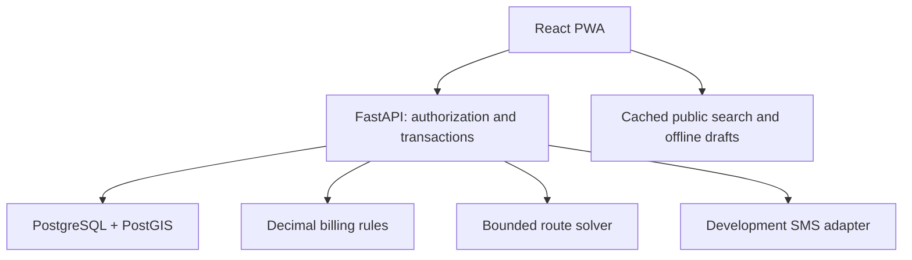
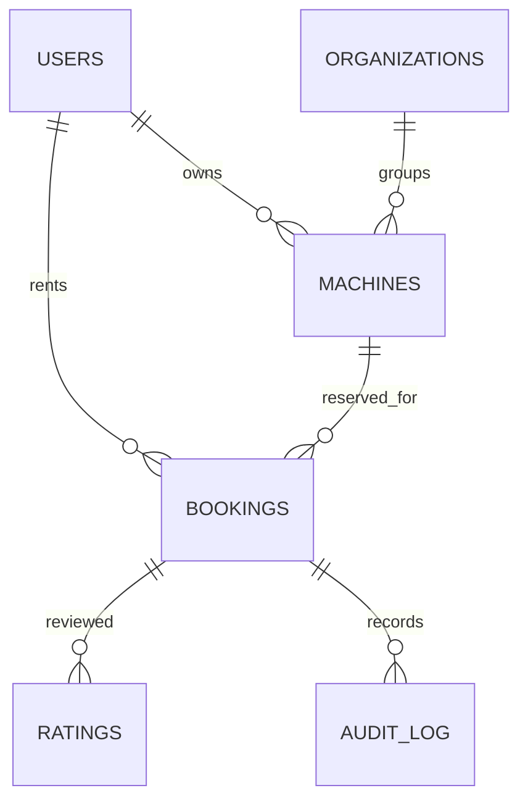

# Architecture and invariants

## Data relationships

Users may have multiple roles. FPO role selection alone grants no other organization's access: each organization has a manager ID and all organization queries check it. Operator job access depends on actual assignment. Admin access is not fabricated or self-granted.

Bookings persist immutable rate/unit/mobilization snapshots and estimated quantities. Final bill derives from the confirmed hour-meter difference or completed acreage; confirmation is bound to those exact submitted values. Decimal arithmetic rounds money to two places using half-up rounding.

Payment reports are independent of operational state and cannot start/complete a booking. They are only editable after completion by the farmer or owner. An operator cannot report a payment. Every change records actor, time, before and after; an invoice is not a verified receipt.

Machine and operator allocation intervals are half-open `[start_at, reserved_until)`. `reserved_until` includes the post-job turnaround buffer. Pending, approved and in-progress bookings participate in exclusions. Rejected/cancelled/completed bookings do not reserve future slots. Maintenance and booking creation lock the same machine row to serialize cross-table checks. API guarantees for maintenance require writes through the service; direct database writes must be restricted in production.

A per-user/idempotency-key advisory lock serializes duplicate submissions. The saved request hash rejects changed payloads under the same key. Reservations do not depend on money collection or payment holds.

Start confirmation locks the machine and rejects another in-progress job, even if its planned interval has elapsed. Work must begin inside the approved interval. End time overruns do not automatically move any later appointment; operational resolution/rescheduling needs further implementation.

OTP issuance and attempts persist in PostgreSQL. Challenges use an HMAC with a secret environment key, expire in five minutes, and allow five guesses. Failed guesses explicitly commit the attempt count. A successful login stores a digest of a random session token; the cookie is HttpOnly/SameSite Strict and lasts 24 hours. Development cookies work on localhost HTTP; public deployment is intentionally disabled. Production needs secure cookies, HTTPS, a live SMS adapter and tested delivery handling.

Search caches contain listing data only. Private API responses have `no-store`. Offline booking drafts are scoped by signed-in user ID and never create a reservation until submitted to the server. Draft submission preserves its idempotency key. Local-device data is not encrypted; do not use real private farm data in this development build.

## API overview

The executable OpenAPI specification is served at `/openapi.json` and `/docs` when the backend runs. Endpoint families: auth, me, machines, availability, maintenance, quotes, bookings, owner actions, operator assignment, meter challenges, payment-report, invoice, rating, audit, notifications, organizations and routes.

## Deployment boundary

Current native development setup is local-only. No hosting provider is selected and no implicit paid resources exist. Preserve FastAPI + PostgreSQL/PostGIS for deployment; do not silently replace them with a hosted KV store or SQLite to fit an incompatible hosting runtime. Source packaging is not proof of successful deployment.
